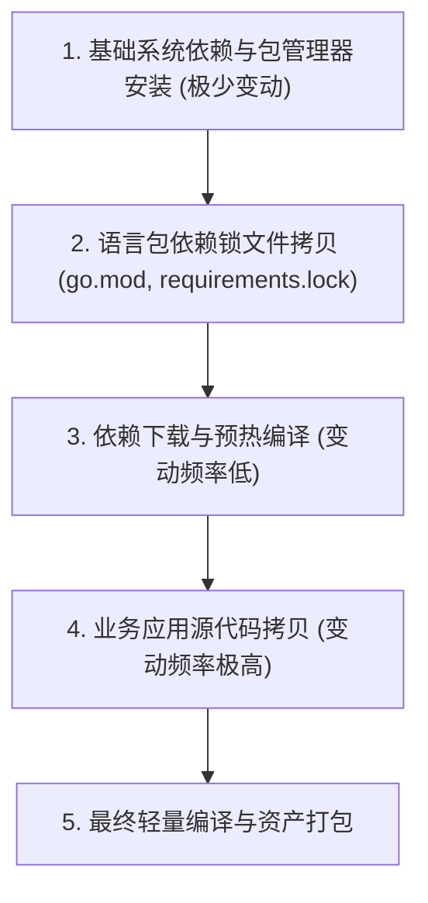

# Docker 生产级容器化架构与安全工程规范技能 (Docker Mastery Skill)

## 概述 (Overview)

本技能定义了在**容器化打包、镜像瘦身构建、容器安全加固、微服务进程治理与 Docker Compose 生产级编排**时的工业级工程规范。
深刻践行 **“构建与运行分离、最小攻击面、Non-root 最小权限、信号平滑透传与可预测构建”** 的容器化第一性原理，吸收 **Docker 官方最佳实践**、**CIS Docker Benchmark** 与云原生 CNCF 标准。

---

# 1. 架构基调与基础镜像选型矩阵 (Base Image Selection)

### 1.1 镜像选型决策表

选型核心原则：**严禁在生产运行时镜像中包含包管理器、源码构建工具或调试 Shell（极致安全与最小体积）**。

| 技术栈 | 推荐构建阶段镜像 (Build Stage) | 推荐生产运行阶段镜像 (Final Runtime) | 核心考量与避坑红线 |
| :--- | :--- | :--- | :--- |
| **Go 静态二进制** | `golang:1.22-alpine` 或 `golang:1.22-bookworm` | `scratch` 或 `gcr.io/distroless/static:nonroot` | 静态编译 `CGO_ENABLED=0`，零攻击面，体积 10~25MB。必须从构建阶段拷贝 `/etc/ssl/certs/ca-certificates.crt` 与时区数据。 |
| **Python (FastAPI / 爬虫)** | `python:3.11-slim-bookworm` | `python:3.11-slim-bookworm` | 🚨 **坚决慎用 Alpine**：musl libc 缺乏预编译 wheels，编译耗时极长且存在内存分配性能劣化与线程堆栈隐患；统一采用官方 `slim-bookworm`。 |
| **Node.js** | `node:20-bookworm-slim` | `node:20-bookworm-slim` | 同样慎用 Alpine 规避原生 C++ 扩展 (如 sharp/grpc) 编译坑。构建后仅保留 `node_modules` 生产依赖并利用 `npm prune --production`。 |
| **PHP (Hyperf / Swoole)** | 官方 Composer 环境 | `hyperf/hyperf:8.1-alpine-v3.18-swoole` 官方优化版 | 预装 Swoole 扩展与 OPCache 调优，锁定底层 Alpine 版本。 |

---

# 2. 镜像多阶段构建与 Layer 缓存黄金军规 (Build & Layer Caching)

### 2.1 变动频次排序原则 (Change Frequency Ordering)
Docker 镜像构建利用分层缓存。编写 `Dockerfile` 时必须严格按照 **“修改频率由低到高”** 排序指令，防止一行业务代码改动导致全量重打依赖：



### 2.2 多阶段构建 (Multi-stage Build) 标杆
编译工具链（Go 编译器、GCC、pip wheel 构建缓存、npm devDependencies）仅停留在 `builder` 阶段，生产层仅以原子方式拷贝产物：

```dockerfile
# 示例：Go 语言多阶段构建
FROM golang:1.22-bookworm AS builder
WORKDIR /src
ENV CGO_ENABLED=0 GOOS=linux
# 先拷贝依赖声明文件
COPY go.mod go.sum ./
RUN go mod download
# 再拷贝源码并静态编译
COPY . .
RUN go build -trimpath -ldflags="-s -w" -o /bin/server ./cmd/server

# 最终纯净运行镜像
FROM gcr.io/distroless/static:nonroot
WORKDIR /app
COPY --from=builder /bin/server /app/server
USER nonroot:nonroot
ENTRYPOINT ["/app/server"]
```

### 2.3 `.dockerignore` 严格资产排查
每个项目根目录**必须**包含严格的 `.dockerignore`，杜绝无关文件与敏感数据进入构建上下文（Build Context）：

```text
# 版本控制与 IDE
.git
.gitignore
.idea
.vscode
*.swp

# 本地环境变量与凭据 (绝命红线)
.env*
*.pem
*.key
*.token
credentials.json

# 依赖库与构建缓存
__pycache__/
*.pyc
*.pyo
venv/
.venv/
node_modules/
dist/
target/
bin/

# 临时数据与日志
*.log
tmp/
scratch/
.coverage
htmlcov/
```

---

# 3. 容器安全与最小权限红线 (Security Hardening Redlines)

以下五大安全军规属于生产环境必须遵守的底线：

1. 🚨 **坚决禁止使用 Root 运行业务容器 (Non-root Rule)**：
   - 必须显式创建无登录权限的专属系统用户与用户组（UID/GID >= 10001）；
   - 使用 `USER` 指令切换，严禁在运行时以 UID 0 运行，杜绝容器逃逸危害宿主机。
2. 🚨 **严禁在镜像层中硬编码敏感凭据 (Zero Hardcoded Secrets)**：
   - 严禁通过 `ENV` 或 `ARG` 固化 API 密钥、数据库密码、Token 等敏感数据（`docker history` 与 `docker inspect` 可直接明文查看）；
   - 敏感信息必须通过运行时环境变量、Docker Secrets 或挂载 Volume 动态注入。
3. 🚨 **基础镜像标签显式锁定 (No Mutable :latest)**：
   - 坚决杜绝使用 `:latest` 作为基础镜像标签。必须锁定主次版本号（如 `python:3.11.9-slim-bookworm`、`alpine:3.19.1`），确保构建具备强可重现性。
4. 🚨 **清理包管理器缓存与临时文件 (Clean Cache in Same Layer)**：
   - 在同一个 `RUN` 指令中完成安装与清理，防止临时缓存膨胀成独立镜像层：
     ```dockerfile
     RUN apt-get update && apt-get install -y --no-install-recommends \
             ca-certificates \
             tzdata \
         && rm -rf /var/lib/apt/lists/*
     ```
5. 🚨 **生产文件系统权限最小化**：
   - 仅授予运行时用户对数据目录或日志目录的读写权限，代码目录保持只读权限。

---

# 4. 进程治理、PID 1 与优雅停机 (Process Lifecycle & Graceful Shutdown)

### 4.1 PID 1 僵尸进程与信号转发机理
在 Linux 容器中，容器的启动命令即为 **1 号进程 (PID 1)**。PID 1 具有特殊职责：
- **信号转发**：Docker 发送 `SIGTERM` 时，PID 1 必须捕获并正确透传给子进程；
- **孤儿进程收割 (Reaping)**：当子进程派生出孤儿进程时，PID 1 必须负责回收，否则会导致僵尸进程 (Zombie Process) 耗尽系统 PID 资源。

| 运行时语言 | 是否需要 init 系统 | 治理方案 |
| :--- | :--- | :--- |
| **Go 语言** | 否 (通常自包含单进程) | Go 应用直接作为 PID 1，应用内部需监听 `os.Interrupt`, `syscall.SIGTERM` 实现平滑优雅退出。 |
| **Python / Shell / Node** | **是 (强制推荐)** | 容器内进程通常缺乏孤儿进程回收能力。必须通过 `tini` 或 `dumb-init` 充当 PID 1。 |

### 4.2 优雅停机三要素
```dockerfile
# 1. 显式指定停机信号 (默认 SIGTERM)
STOPSIGNAL SIGTERM

# 2. 引入 tini 充当 PID 1 收割进程与信号透传
RUN apt-get update && apt-get install -y --no-install-recommends tini && rm -rf /var/lib/apt/lists/*
ENTRYPOINT ["/usr/bin/tini", "--"]

# 3. 必须使用 Exec 格式 (方括号)，严禁使用 Shell 格式
CMD ["python", "main.py"]
```
*(注：如果写成 `CMD python main.py`，Docker 会以 `/bin/sh -c "python main.py"` 启动，`/bin/sh` 不会转发信号给 Python，停机超时后会被 Docker 暴力 `SIGKILL` 杀死！)*

---

# 5. 健康检查与生产探针标准 (HEALTHCHECK Specification)

生产容器应显式配置原生 `HEALTHCHECK`，以便容器编排引擎（Docker Swarm / Compose / K8s）感知服务真实就绪状态，防止流量分发至未就绪或假死实例：

```dockerfile
HEALTHCHECK --interval=30s --timeout=5s --start-period=10s --retries=3 \
    CMD curl -f http://127.0.0.1:8000/healthz || exit 1
```

- `--interval=30s`：常规探测频率，避免过高压垮业务；
- `--timeout=5s`：探测单次超时时间；
- `--start-period=10s`：应用冷启动预热期（此期间内失败不计入重试次数）；
- `--retries=3`：连续失败 3 次标记容器为 `unhealthy`。

---

# 6. 核心语言生产级标杆 Dockerfile (Production Templates)

### 6.1 Python (FastAPI 现代异步生产级模版)
```dockerfile
# ==============================================================================
# 阶段 1: 依赖编译与构建
# ==============================================================================
FROM python:3.11-slim-bookworm AS builder

ENV PYTHONUNBUFFERED=1 \
    PYTHONDONTWRITEBYTECODE=1 \
    PIP_NO_CACHE_DIR=1 \
    PIP_DISABLE_PIP_VERSION_CHECK=1

WORKDIR /install

RUN apt-get update && apt-get install -y --no-install-recommends \
        build-essential \
        libpq-dev \
    && rm -rf /var/lib/apt/lists/*

COPY requirements.txt .
RUN pip install --prefix=/install/deps -r requirements.txt

# ==============================================================================
# 阶段 2: 极简纯净运行时
# ==============================================================================
FROM python:3.11-slim-bookworm AS runtime

ENV PYTHONUNBUFFERED=1 \
    PYTHONDONTWRITEBYTECODE=1 \
    PATH="/app/deps/bin:$PATH" \
    PYTHONPATH="/app/deps/lib/python3.11/site-packages:$PYTHONPATH"

WORKDIR /app

# 安装运行时动态链接库与 tini
RUN apt-get update && apt-get install -y --no-install-recommends \
        ca-certificates \
        tzdata \
        tini \
        libpq5 \
        curl \
    && rm -rf /var/lib/apt/lists/*

# 创建专属非特权用户
RUN groupadd -g 10001 appuser && \
    useradd -u 10001 -g appuser -s /bin/false -M -d /app appuser

# 从构建阶段拷贝依赖包与资产
COPY --from=builder --chown=appuser:appuser /install/deps /app/deps
COPY --chown=appuser:appuser . /app/

USER appuser:appuser

EXPOSE 8000
STOPSIGNAL SIGTERM

HEALTHCHECK --interval=30s --timeout=3s --start-period=5s --retries=3 \
    CMD curl -f http://127.0.0.1:8000/healthz || exit 1

ENTRYPOINT ["/usr/bin/tini", "--"]
CMD ["uvicorn", "main:app", "--host", "0.0.0.0", "--port", "8000", "--workers", "4"]
```

---

### 6.2 Go (go-zero / 高并发微服务超轻量模版)
```dockerfile
# ==============================================================================
# 阶段 1: 静态编译
# ==============================================================================
FROM golang:1.22-bookworm AS builder

ENV CGO_ENABLED=0 \
    GOOS=linux \
    GOARCH=amd64

WORKDIR /build

# 依赖层缓存预热
COPY go.mod go.sum ./
RUN go mod download

# 源码拷贝与优化编译
COPY . .
RUN go build -trimpath -ldflags="-s -w -buildid=" -o /build/app-service .

# ==============================================================================
# 阶段 2: Scratch / Distroless 超轻量运行
# ==============================================================================
FROM alpine:3.19 AS certs
RUN apk --no-cache add ca-certificates tzdata

FROM scratch AS runtime

WORKDIR /app

# 证书与时区支持
COPY --from=certs /etc/ssl/certs/ca-certificates.crt /etc/ssl/certs/
COPY --from=certs /usr/share/zoneinfo /usr/share/zoneinfo
ENV TZ=Asia/Shanghai

# 拷贝编译产物与静态配置
COPY --from=builder /build/app-service /app/app-service
COPY --from=builder /build/etc /app/etc

EXPOSE 8888
STOPSIGNAL SIGTERM

ENTRYPOINT ["/app/app-service", "-f", "etc/app.yaml"]
```

---

# 7. Docker Compose 生产编排规范 (Compose Architecture)

在编写 `docker-compose.yml` 时，必须实施网络隔离与健康依赖检查：

```yaml
version: '3.8'

networks:
  frontend:
    driver: bridge
  backend:
    internal: true # 🚨 后端内网隔离，禁止向宿主机外部暴露端口

volumes:
  mysql_data:
  redis_data:

services:
  mysql:
    image: mysql:8.0.36
    restart: unless-stopped
    networks:
      - backend
    environment:
      MYSQL_ROOT_PASSWORD_FILE: /run/secrets/db_root_password
      MYSQL_DATABASE: app_db
    volumes:
      - mysql_data:/var/lib/mysql
    healthcheck:
      test: ["CMD", "mysqladmin", "ping", "-h", "localhost"]
      interval: 10s
      timeout: 5s
      retries: 3

  api:
    build:
      context: .
      dockerfile: Dockerfile
    restart: unless-stopped
    networks:
      - frontend
      - backend
    ports:
      - "8000:8000"
    depends_on:
      mysql:
        condition: service_healthy # 🚨 必须等待 MySQL 探针就绪再启动服务
    environment:
      - ENV=production
      - DB_HOST=mysql
```

---

# 8. 常见高危反模式与排障检查单 (Anti-patterns & Checklist)

| 高危反模式 (Anti-pattern) | 潜在致命后果 | 规范化解决方案 |
| :--- | :--- | :--- |
| **基础镜像使用 `:latest`** | 构建环境漂移，偶发依赖不兼容引发生产故障 | 强制显式锁定语义化版本号 (如 `python:3.11.9-slim`) |
| **无 `.dockerignore` 或忽视敏感文件** | `.git` 与 `.env` 凭据被打包进公开镜像造成严重安全泄露 | 强制部署标准 `.dockerignore` 模板并 CI 门禁检查 |
| **Shell 格式启动主进程 (`CMD node index.js`)** | 无法接收 `SIGTERM` 停机信号，停机必定超市并被暴力 `SIGKILL` | 强制使用 Exec 格式 (`CMD ["node", "index.js"]`) 并配置 `tini` |
| **Python 项目盲目选用 Alpine** | 缺少 wheel 预编译库导致构建极慢，musl 内存分配器高并发性能劣化 | 统一选用 Debian `slim-bookworm` 官方轻量版 |
| **以 Root 权限常驻运行** | 一旦应用发生任意命令执行漏洞 (RCE)，攻击者直接获取容器内 root | 强制创建并切换至 `USER appuser` (UID 10001) |
